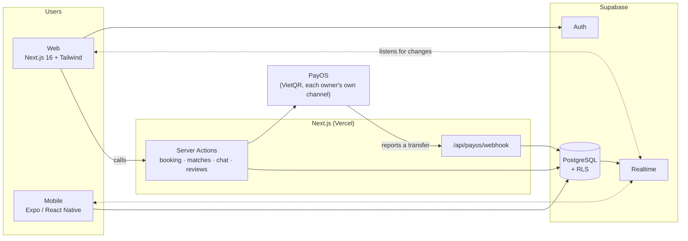
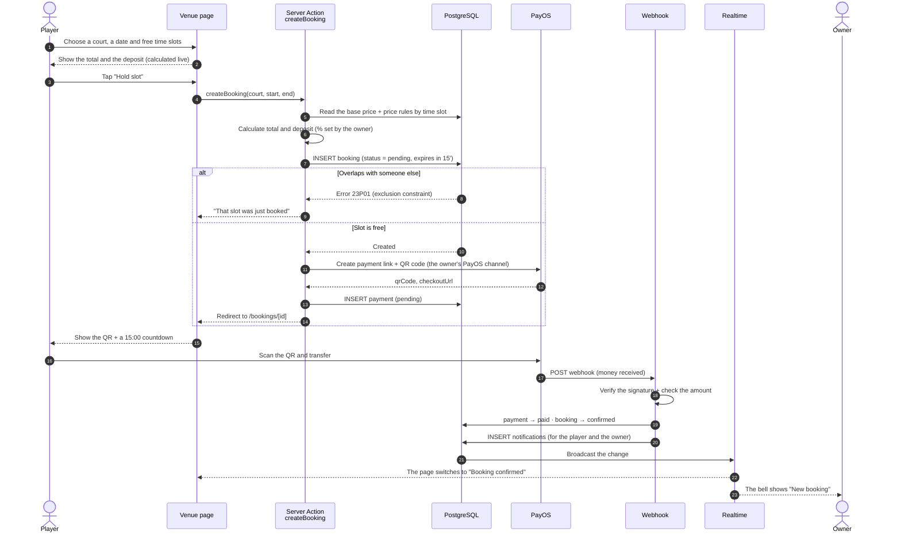
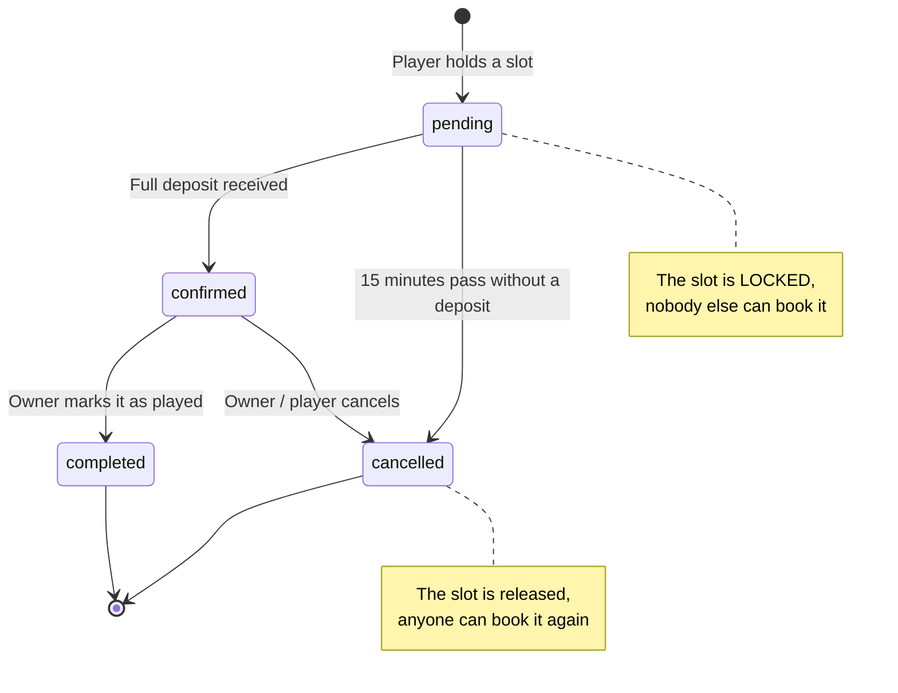
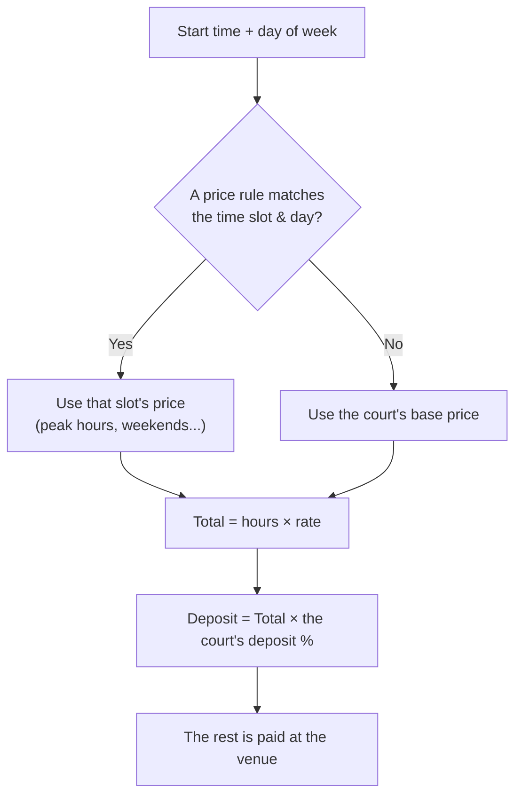
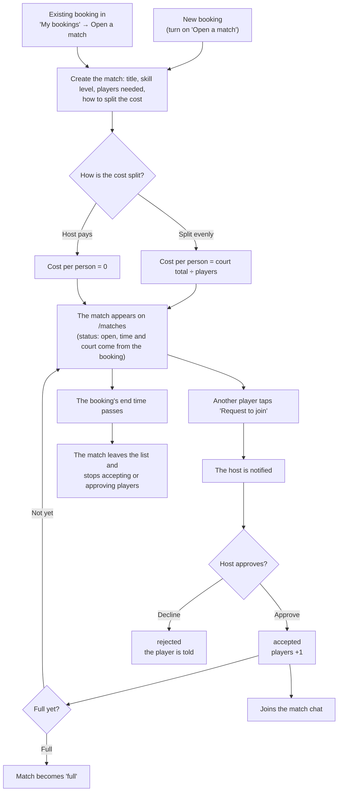
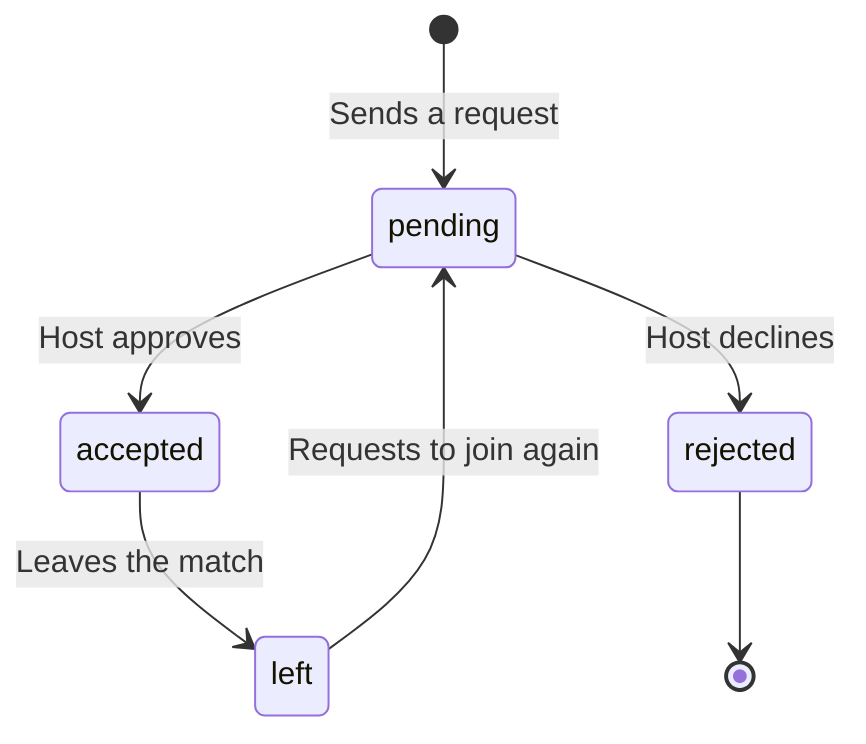
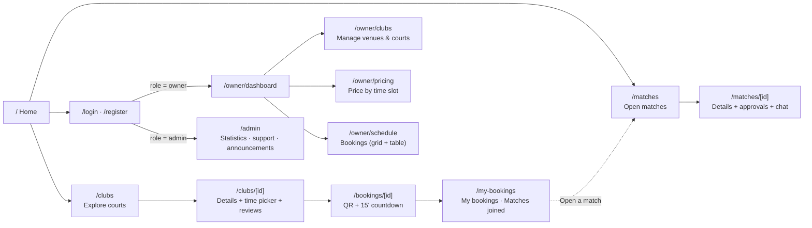
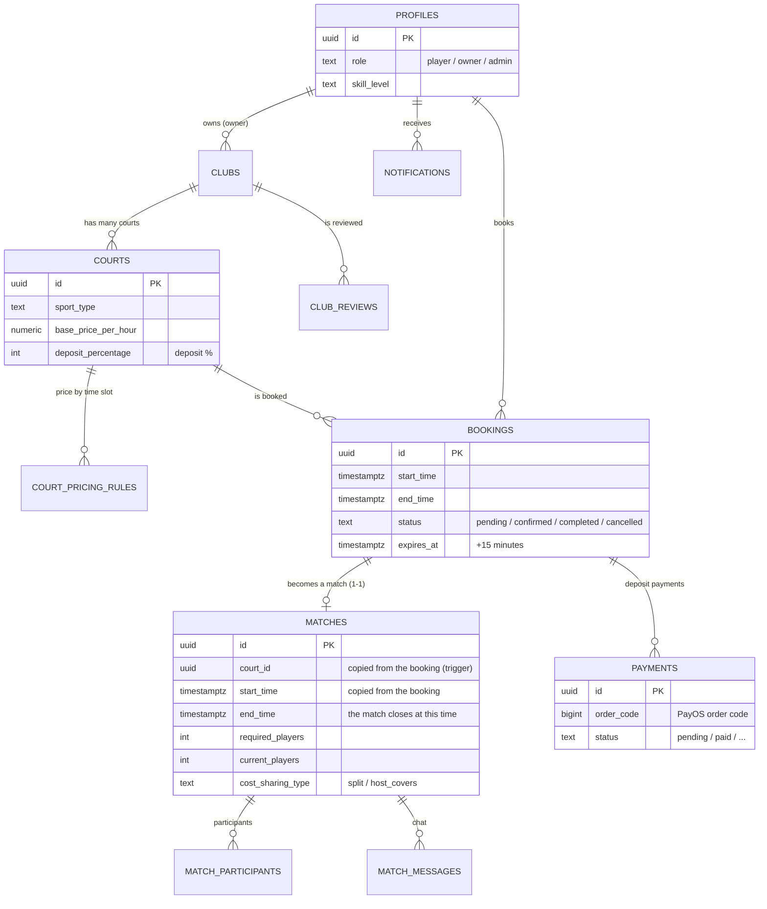

<div align="center">


# SportArena

**Book sports courts and find players for friendly matches, in real time.**

Pick a free slot, pay the deposit with a VietQR code and invite more players to your match. Every venue owner is paid straight into their own bank account.

`Next.js 16` · `React 19` · `Tailwind v4` · `Supabase` · `PayOS` · `Expo`

[Tiếng Việt](README.md) · **English**

</div>

<table>
  <tr>
    <td width="50%"></td>
    <td width="50%"></td>
  </tr>
  <tr>
    <td></td>
    <td></td>
  </tr>
</table>

## Features

**Players**
- Find venues by sport (football, badminton, pickleball, tennis, basketball) and area, with a map and directions.
- Click a venue card to preview photos, address, opening hours, amenities and its courts right on the list; each court has a detail dialog (surface, deposit, price by time slot, cancellation policy).
- Choose a time slot on the calendar; price by time slot and the deposit are calculated automatically, and the slot is held for 15 minutes with a countdown. Past hours are struck out automatically (by start time, refreshed every 30 seconds), and durations that would overlap someone else's booking are locked, so you cannot pick a slot that is already taken.
- Pay the deposit with a QR code. The status updates the moment the transfer lands, with no page reload.
- Open a match while booking: set the skill level, split the court cost, let the host approve each player and chat inside the match. The match carries the booking's time and court; once its end time passes it disappears from the list and stops accepting players (a match in progress shows a "Live" badge).
- Cancel a booking yourself under the venue's policy: early cancellations are refunded, late ones forfeit the deposit, and an owner cancellation always refunds in full. Track the refund status right in the booking.
- Player profile: avatar, skill level, phone number and a public profile page with statistics.
- Real-time notifications, venue reviews and support requests.
- Match hosts approve or decline join requests right from the push notification (Approve / Decline buttons).
- Owners can use the mobile app (Owner tab) to confirm bank-transfer deposits, cancel bookings, mark them as played, refund deposits and call customers. The same tab has a Venues & prices section to manage venues: create or delete venues, upload photos, pin the location with the phone's GPS, add, edit, switch off or delete courts, and add, edit or delete price slots.
- On the mobile app: book (and open a match at the same time), pay the deposit, cancel, change your avatar, view player profiles and receive push notifications.
- The web interface and the mobile app are available in **Vietnamese and English** (web: language button in the header; mobile: Profile tab; the default follows your browser or phone). This covers the owner and admin areas and notifications too (new notifications are stored with an English copy; older ones stay Vietnamese).

**Venue owners**
- Manage venues, courts, opening hours and location; upload venue photos directly (JPG, PNG, WebP) and choose a cover. Edit venue details (name, address, description, area, opening hours, amenities) and court details (name, surface, base price, deposit %) on both web and mobile.
- A venue only appears in the public list once it can receive payments (PayOS or a VietQR bank account); until then the owner sees a notice linking to the payments page. Linking a bank account also works from the mobile app.
- Flexible pricing by time slot and day of the week, with a deposit percentage per court.
- A real-time schedule, with a notification whenever a customer pays a deposit.
- Two ways to receive deposits, always straight into the owner's bank account: connect your own PayOS account (confirmed automatically), or enter your bank account so customers transfer by VietQR and you confirm manually.
- Set your own cancellation policy (hours of free cancellation) and manage the list of bookings that need a refund.
- Free and Pro plans for venues.

**Platform administration**
- Operations statistics: users, venues, bookings, transaction value, plan revenue and daily charts.
- A support inbox (tickets) between administrators, owners and players.
- An AI assistant (Claude) answers booking and account tickets by itself when the answer is covered by a short knowledge base. Payment and technical tickets, tickets the assistant is unsure about, users asking for a human, and tickets a human already answered always go to the administrators, and any API error escalates instead of sending anything to the user. Off by default; it only runs when `ANTHROPIC_API_KEY` is set.
- Announcements for updates or maintenance, sent to any group of users.

**Interface**: light and dark themes, readable contrast, works on phones, with an Expo mobile app. The owner and admin areas are bilingual too. The home page has a 3D background (Three.js): sports balls bounce around the frame and collide elastically; it is off for users who prefer reduced motion or devices without WebGL.

## Technical highlights

- **Never a double booking.** Enforced in Postgres with an exclusion constraint on the time range, so if two people tap at once only one gets the slot. Expired holds are released automatically by pg_cron.
- **Matches tied to the booking's time window.** `bookings` is readable only by the booking owner and the venue owner (RLS), so a match's time and court are copied onto `matches` by triggers; other players can see them without exposing price or payment. Closing a match at its end time is enforced in several layers (RLS policy, `MATCH_ENDED` trigger, Server Actions) because the mobile app writes to the table directly.
- **No server/browser drift.** "Now" values (past slots, live matches) are fixed by the server and passed down, then keep ticking on the client, which avoids hydration mismatches.
- **Reliable payments.** The PayOS webhook verifies the signature with the right channel for each booking, checks the amount, is idempotent and returns error codes so PayOS retries when needed.
- **One payment channel per owner.** PayOS keys are encrypted with AES-256-GCM before storage, readable only by the server and never sent to the browser.
- **Defence in depth.** Row Level Security is on for every table, users cannot write to business tables directly, and every write goes through a Server Action that checks permissions. Those rules have their own SQL test suite running in Docker. Scripts are protected by a per-request nonce Content-Security-Policy with no `unsafe-inline`.
- **Realtime.** Bookings, matches, chat, notifications and tickets update through Supabase Realtime.
- **Consistent Vietnam time zone.** Display and statistics use Vietnam time even when the server runs in UTC.
- **Forgot password.** Users get an email with a reset link (web and mobile app). The link also works on another device, only allows changing the password within an hour, and signs out other devices afterwards. Emails are rate limited per IP and per address, and the response never reveals which emails are registered.
- **Testing and CI.** Over 400 Vitest tests for business logic, over 200 SQL cases for RLS and constraints, and GitHub Actions running typecheck, lint, tests, build, Playwright end-to-end tests (logins for the three roles, role guards, both languages, the nonce CSP check), a second Playwright suite that runs the write flows (booking, confirmation, cancellation, refunds, matches, photos) against a real Supabase in Docker, and the mobile typecheck on every push.
- **Bilingual UI.** Cookie-based language selection with `next-intl` (no URL changes); a test fails if an English string is missing or a placeholder differs, and server error messages are translated at the boundary.

## Technology

| Layer | Technology |
| :-- | :-- |
| Web | Next.js 16 (App Router, Server Actions), React 19, Tailwind CSS v4, shadcn/ui on Base UI, next-intl |
| Data | Supabase: Postgres, Auth, RLS, Realtime |
| Payments | PayOS v2 (VietQR) |
| Mobile | Expo, React Native |
| 3D | Three.js (home page background, loaded dynamically) |
| Support assistant | Claude via `@anthropic-ai/sdk` (optional) |
| Testing | Vitest, SQL tests in Docker, Playwright |
| Infrastructure | Vercel or Docker, GitHub Actions |

## Structure

```
web/        Next.js app (pages, Server Actions, webhooks, UI, tested logic)
mobile/     Expo app
supabase/   Migrations (schema, RLS, SQL functions) and the security test suite
docs/       Screenshots
```

Related documents: [How it works](#how-it-works) (with diagrams), [Design guidelines](DESIGN.md), [Deployment guide](DEPLOYMENT.md). These last two are written in Vietnamese.

## Getting started

You need Node.js 20 or newer and a free [Supabase](https://supabase.com) project. A PayOS key is not required: the dev environment can simulate payments.

```bash
git clone https://github.com/tuan2304/sportarena.git
cd sportarena/web
npm install
cp .env.example .env.local        # fill in the 3 Supabase variables at the top
```

Create the schema on your Supabase project (requires the [Supabase CLI](https://supabase.com/docs/guides/cli)), then run:

```bash
supabase link --project-ref <project-ref>
supabase db push
npm run dev                       # http://localhost:3000
```

Other commands, run in `web/`:

| Command | What it does |
| :-- | :-- |
| `npm run check` | Typecheck, lint and tests, same as CI |
| `npm run db:test` | Apply the migrations to a throwaway Postgres in Docker and run the RLS tests |
| `npm run e2e` | Build and run the Playwright end-to-end tests against a mock Supabase (run `npm run e2e:install` once first) |
| `npm run e2e:real` | Run the write-flow Playwright tests against a real local Supabase (needs Docker and the Supabase CLI; run `supabase start` in the project root first, or point `E2E_SUPABASE_WORKDIR` at a separate config if another local Supabase already uses the default ports) |
| `npm run build` | Production build |

Optional environment variables: `ANTHROPIC_API_KEY` (turns on the AI ticket assistant; `SUPPORT_AI_ENABLED=false` switches it off, `SUPPORT_AI_MODEL` overrides the model). See `.env.example`.

Mobile app: `cd mobile && npm install`, copy `.env.example` to `.env` and add `EXPO_PUBLIC_API_URL` (the web server address, used to hold slots, cancel bookings and report transfers), then `npm start`. The login session is kept in the Keychain/Keystore. Pricing, time, cancellation and profile logic is shared with the web through `npm run sync:mobile` (in `web/`); a test fails if the two copies drift apart.

## How it works

This section explains the steps a user goes through and what the system does behind the scenes. The Mermaid diagrams render automatically on GitHub. In VS Code, open the file and press `Ctrl+Shift+V` (needs the *Markdown Preview Mermaid Support* extension).

### Architecture



The web app does not poll the server. When the database changes (a deposit, a join request, a new message), Supabase Realtime pushes the change to the browser and the UI updates itself.

### Booking, deposit, confirmation

This is the most important flow in the product.



**Life of a booking**



**Why can't bookings overlap?** It is not checked in code, because two people tapping at once would both slip through. The database has a constraint:

```sql
EXCLUDE USING gist (court_id WITH =, during WITH &&)
WHERE (status IN ('pending', 'confirmed'))
```

For the same court, with overlapping time ranges and an active booking, Postgres refuses. Whoever taps first gets the slot, and the other person sees a friendly error.

**How the price is calculated**



### Matchmaking

A player who has a court but needs more people opens a match for others to join.



**Participant states**



### Realtime: which screen listens to which table

| Screen | Table listened to | What the user sees |
| :-- | :-- | :-- |
| `/bookings/[id]` | `bookings` | "Awaiting deposit" switches to "Success" by itself |
| `/owner/schedule` | `bookings` | The owner's schedule gets new bookings instantly |
| `/matches/[id]` | `match_participants`, `matches` | The member list and open spots update by themselves |
| Match chat box | `match_messages` | New messages appear at once, no refresh needed |
| Venue reviews | `club_reviews` | New reviews appear at once |
| Notification bell | `notifications` | The red badge grows and a popup appears |

### Site map



### Database



The diagram only shows the core tables. There are more for notifications, chat, reviews, each owner's PayOS keys, subscriptions, support (tickets) and system announcements. All of them have Row Level Security on, and `profiles` restricts reads by column: guests only see the publicly displayed information, and the phone number is visible only to a venue owner through a dedicated function.

## Roadmap

- Close ended matches automatically with a scheduled job: today an ended match is only hidden and stops accepting players, while the "open matches" figure in the admin statistics still counts by status.
- Automatic deposit refunds through the payment provider's API (today the owner transfers the money back and confirms).
- More automatic payment gateways (MoMo, VNPay...) alongside PayOS and manual transfer.
- Mobile: reordering venue photos by drag and drop and picking the location on a map (today the location is pinned with GPS at the venue).
- End-to-end tests for online payments through PayOS: `npm run e2e:real` already covers booking, manual transfer, cancellation and refunds, open matches and photos on a real Supabase, but does not call PayOS because that needs sandbox keys.
