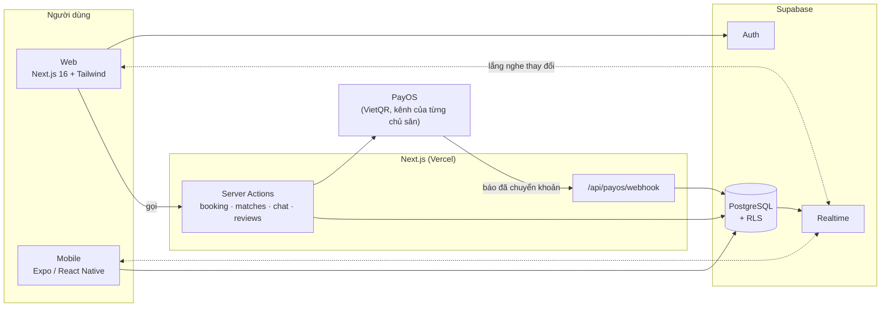
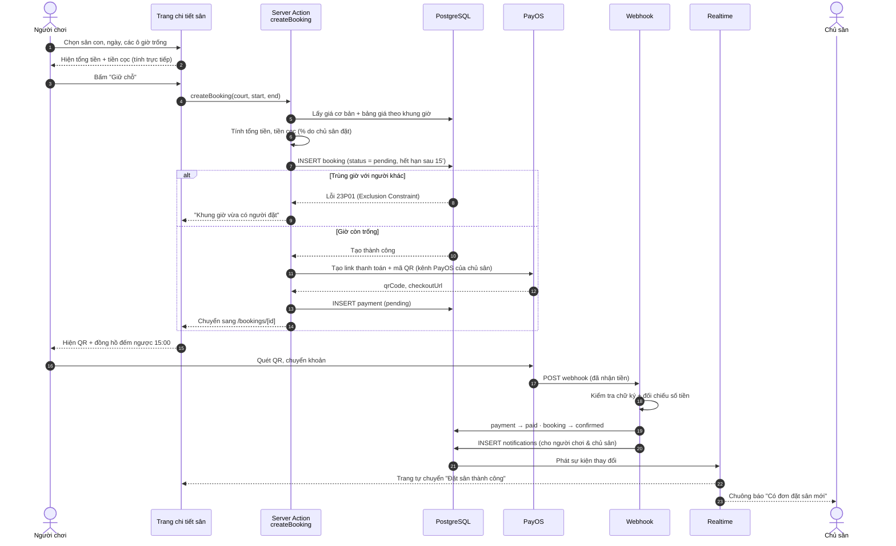
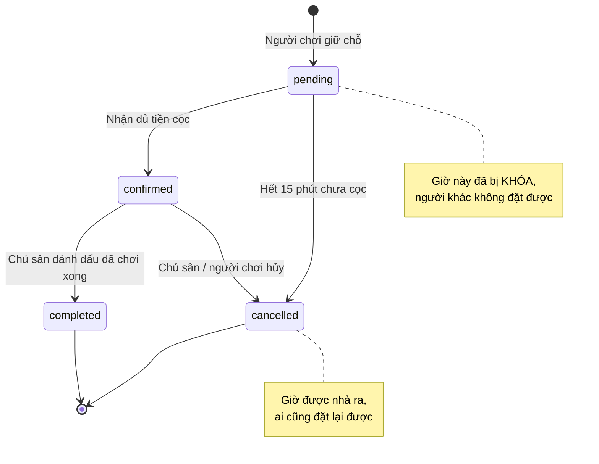
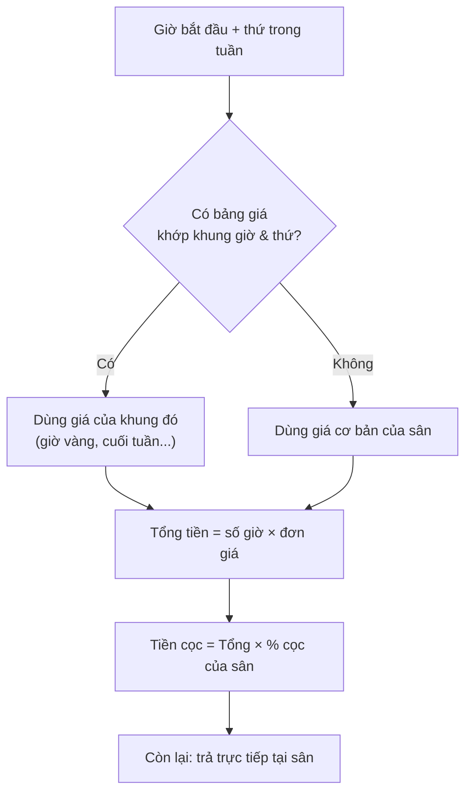
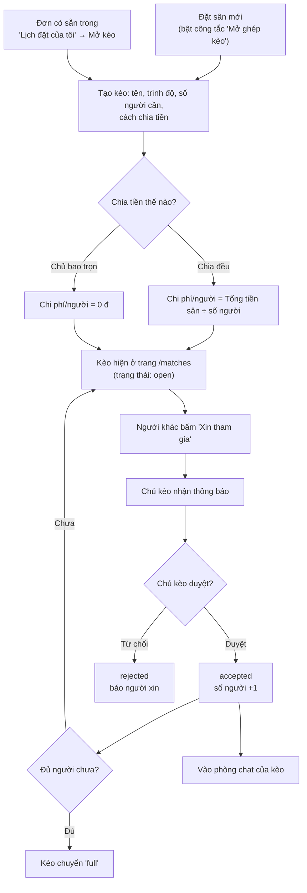
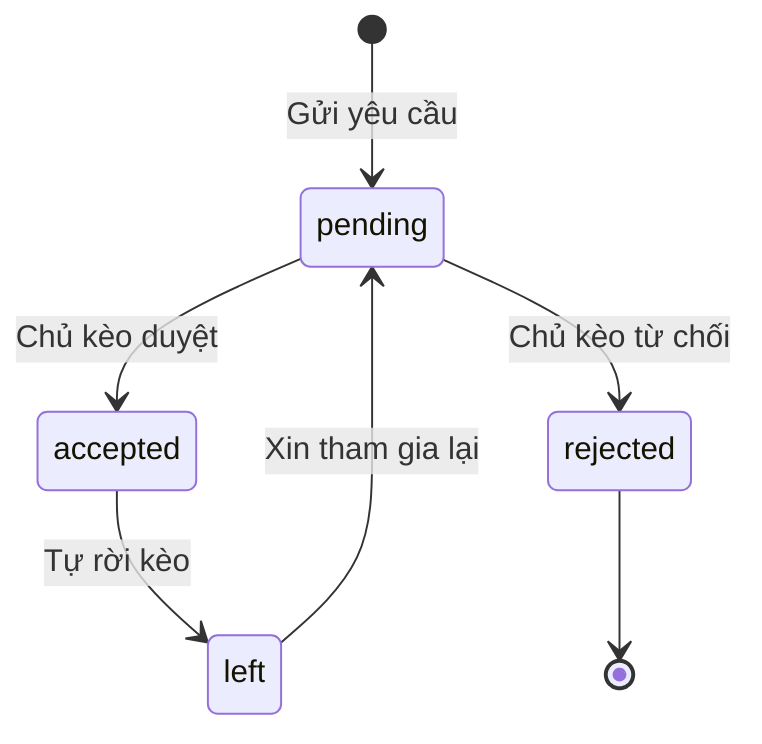
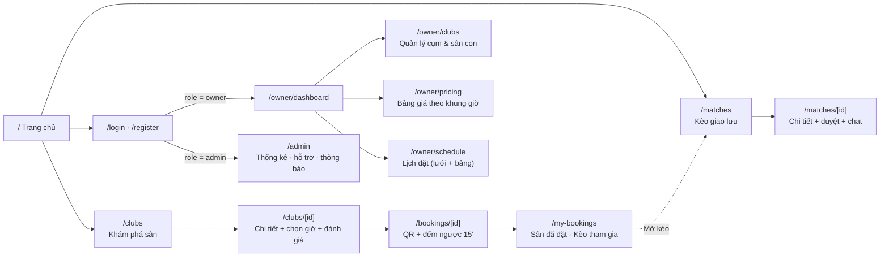
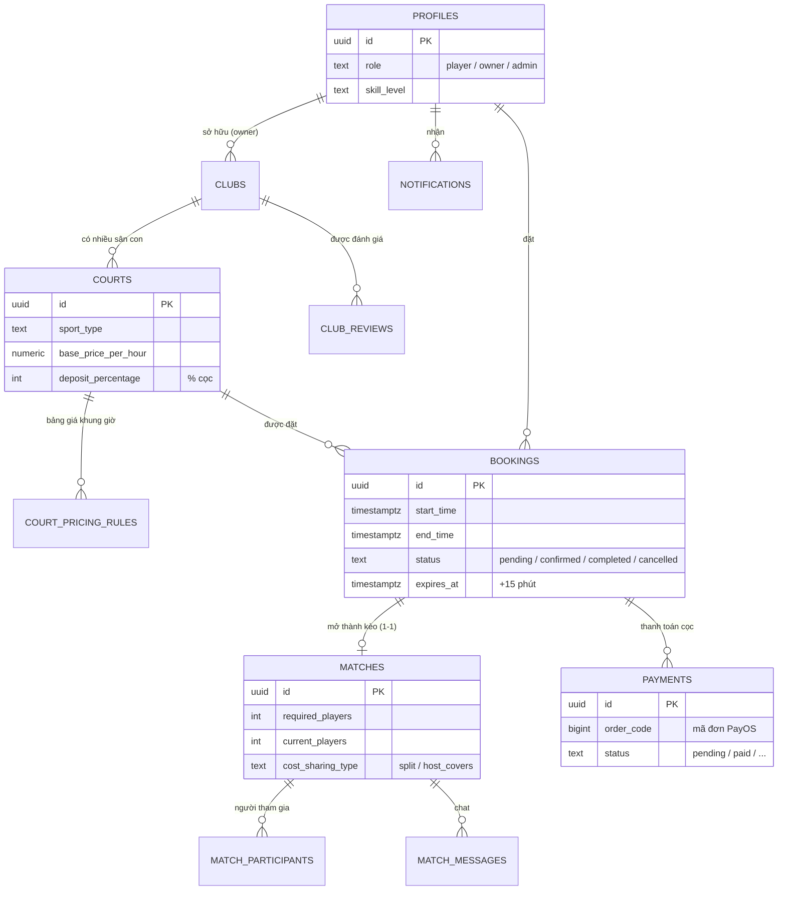

<div align="center">


# SportArena

**Đặt sân thể thao và ghép kèo giao lưu theo thời gian thực.**

Chọn giờ trống, cọc bằng mã VietQR, rủ thêm người chơi vào kèo. Mỗi chủ sân nhận tiền thẳng vào tài khoản của mình.

`Next.js 16` · `React 19` · `Tailwind v4` · `Supabase` · `PayOS` · `Expo`

**Tiếng Việt** · [English](README.en.md)

</div>

<table>
  <tr>
    <td width="50%"></td>
    <td width="50%"></td>
  </tr>
  <tr>
    <td></td>
    <td></td>
  </tr>
</table>

## Tính năng

**Người chơi**
- Tìm cụm sân theo môn (bóng đá, cầu lông, pickleball, tennis, bóng rổ) và khu vực, xem bản đồ và chỉ đường.
- Chọn khung giờ trên lịch, hệ thống tự tính giá theo khung giờ và tiền cọc, giữ chỗ 15 phút có đồng hồ đếm ngược.
- Cọc bằng mã QR, trạng thái cập nhật ngay khi chuyển khoản xong, không cần tải lại trang.
- Mở kèo giao lưu ngay lúc đặt sân: chọn trình độ, chia tiền sân, chủ kèo duyệt từng người, chat trong kèo.
- Tự hủy đơn theo chính sách của cụm sân: hủy sớm được hoàn cọc, hủy muộn mất cọc, chủ sân hủy thì luôn hoàn đủ. Theo dõi trạng thái hoàn cọc ngay trong đơn.
- Hồ sơ người chơi: ảnh đại diện, trình độ, số điện thoại và trang hồ sơ công khai có thống kê.
- Thông báo realtime, đánh giá sân, gửi yêu cầu hỗ trợ.
- Đặt sân (kèm mở kèo ghép ngay lúc đặt), thanh toán cọc, hủy đơn, đổi ảnh đại diện, xem hồ sơ người chơi và nhận thông báo đẩy ngay trên ứng dụng mobile.
- Giao diện web có **tiếng Việt và tiếng Anh**: đổi bằng nút ngôn ngữ trên thanh đầu trang, mặc định theo trình duyệt (khu vực chủ sân và quản trị hiện mới có tiếng Việt).

**Chủ sân**
- Quản lý cụm sân, sân con, giờ mở cửa và vị trí; tải ảnh sân trực tiếp (JPG, PNG, WebP), chọn ảnh bìa.
- Bảng giá linh hoạt theo khung giờ và ngày trong tuần, tự đặt phần trăm cọc cho từng sân.
- Lịch đặt realtime, nhận thông báo khi có khách cọc.
- Hai cách nhận cọc, tiền luôn về thẳng tài khoản ngân hàng của chủ sân: kết nối PayOS riêng (tự xác nhận) hoặc khai báo tài khoản để khách chuyển khoản theo VietQR rồi chủ sân xác nhận thủ công.
- Tự đặt chính sách hủy sân (số giờ hủy miễn phí) và quản lý danh sách đơn cần hoàn cọc.
- Gói Free và Pro cho cụm sân.

**Quản trị nền tảng**
- Thống kê vận hành: người dùng, cụm sân, lượt đặt, giá trị giao dịch, doanh thu thuê gói, biểu đồ theo ngày.
- Hộp thư hỗ trợ (ticket) giữa quản trị với chủ sân và người chơi.
- Gửi thông báo cập nhật hoặc bảo trì tới từng nhóm người dùng.

**Giao diện**: sáng và tối, đủ tương phản chữ, dùng được trên điện thoại, có ứng dụng mobile bằng Expo.

## Điểm kỹ thuật đáng chú ý

- **Không bao giờ trùng lịch.** Chặn ở tầng Postgres bằng exclusion constraint trên khoảng thời gian, nên hai người bấm cùng lúc thì chỉ một người giữ được chỗ. Chỗ giữ quá hạn được nhả tự động bằng pg_cron.
- **Thanh toán đáng tin cậy.** Webhook PayOS kiểm tra chữ ký theo đúng kênh của từng đơn, đối chiếu số tiền, xử lý lặp an toàn (idempotent) và trả mã lỗi để PayOS tự gọi lại khi cần.
- **Mỗi chủ sân một kênh thanh toán.** Khóa PayOS được mã hóa AES-256-GCM trước khi lưu, chỉ server đọc được và không bao giờ trả về trình duyệt.
- **Bảo mật nhiều lớp.** Mọi bảng bật Row Level Security, người dùng không có quyền ghi trực tiếp vào bảng nghiệp vụ, mọi thao tác ghi đi qua Server Action có kiểm tra quyền. Các quy tắc đó có bộ test SQL riêng chạy trong Docker.
- **Realtime.** Lịch đặt, kèo, chat, thông báo và ticket cập nhật qua Supabase Realtime.
- **Múi giờ Việt Nam nhất quán.** Hiển thị và thống kê đều tính theo giờ Việt Nam, kể cả khi máy chủ chạy UTC.
- **Kiểm thử và CI.** Hơn 150 test Vitest cho logic nghiệp vụ, bộ test RLS bằng SQL, GitHub Actions chạy typecheck, lint, test, build, kiểm thử đầu-cuối bằng Playwright (kèm kiểm tra CSP có nonce) và kiểm tra mobile ở mỗi lần push.

## Công nghệ

| Lớp | Công nghệ |
| :-- | :-- |
| Web | Next.js 16 (App Router, Server Actions), React 19, Tailwind CSS v4, shadcn/ui trên Base UI |
| Dữ liệu | Supabase: Postgres, Auth, RLS, Realtime |
| Thanh toán | PayOS v2 (VietQR) |
| Mobile | Expo, React Native |
| Kiểm thử | Vitest, test SQL trong Docker |
| Hạ tầng | Vercel hoặc Docker, GitHub Actions |

## Cấu trúc

```
web/        Ứng dụng Next.js (trang, Server Actions, webhook, giao diện, logic có test)
mobile/     Ứng dụng Expo
supabase/   Migration (schema, RLS, hàm SQL) và bộ test bảo mật
docs/       Ảnh minh họa
```

Tài liệu đi kèm: [Luồng hoạt động](#luồng-hoạt-động) (có sơ đồ), [Quy chuẩn thiết kế](DESIGN.md), [Hướng dẫn triển khai](DEPLOYMENT.md).

## Chạy thử

Cần Node.js 20 trở lên và một project [Supabase](https://supabase.com) miễn phí. Chưa cần khóa PayOS: môi trường dev có chế độ giả lập thanh toán.

```bash
git clone https://github.com/tuan2304/pickleball-booking.git
cd pickleball-booking/web
npm install
cp .env.example .env.local        # điền 3 biến Supabase ở đầu file
```

Tạo schema trên project Supabase của bạn (cần [Supabase CLI](https://supabase.com/docs/guides/cli)), rồi chạy:

```bash
supabase link --project-ref <project-ref>
supabase db push
npm run dev                       # http://localhost:3000
```

Các lệnh khác, chạy trong `web/`:

| Lệnh | Việc làm |
| :-- | :-- |
| `npm run check` | Typecheck, lint và test, giống CI |
| `npm run db:test` | Áp migration lên Postgres tạm trong Docker và chạy test RLS |
| `npm run build` | Build production |

Ứng dụng mobile: `cd mobile && npm install`, sao chép `.env.example` thành `.env` rồi điền thêm `EXPO_PUBLIC_API_URL` (địa chỉ máy chủ web, dùng để giữ chỗ, hủy đơn và báo đã chuyển khoản), sau đó `npm start`. Phiên đăng nhập được lưu trong Keychain/Keystore. Logic tính giá, giờ, hủy đơn và hồ sơ được dùng chung với web qua `npm run sync:mobile` (trong `web/`); một test sẽ báo lỗi nếu hai bản lệch nhau.

## Luồng hoạt động

Phần này giải thích người dùng đi qua những bước nào và hệ thống xử lý gì phía sau. Các sơ đồ Mermaid tự hiển thị trên GitHub. Trong VS Code, mở file rồi nhấn `Ctrl+Shift+V` (cần extension *Markdown Preview Mermaid Support*).

### Kiến trúc



Web không phải hỏi lại server liên tục. Khi database đổi (có cọc, có người xin vào kèo, có tin nhắn mới), Supabase Realtime đẩy thay đổi xuống trình duyệt và giao diện tự cập nhật.

### Đặt sân, cọc, xác nhận

Đây là luồng quan trọng nhất của sản phẩm.



**Vòng đời của một đơn đặt sân**



**Vì sao không bao giờ trùng lịch?** Không kiểm tra bằng code, vì hai người bấm cùng lúc sẽ lọt qua. Database có ràng buộc:

```sql
EXCLUDE USING gist (court_id WITH =, during WITH &&)
WHERE (status IN ('pending', 'confirmed'))
```

Cùng một sân, khoảng giờ giao nhau và đơn còn hiệu lực thì Postgres từ chối. Ai bấm trước được giữ chỗ, người sau nhận thông báo lỗi thân thiện.

**Cách tính giá**



### Ghép kèo

Người chơi đã có sân nhưng thiếu người thì mở một kèo để mọi người cùng tham gia.



**Trạng thái người tham gia**



### Realtime: màn hình nào nghe bảng nào

| Màn hình | Bảng được lắng nghe | Kết quả người dùng thấy |
| :-- | :-- | :-- |
| `/bookings/[id]` | `bookings` | Đang chờ cọc tự chuyển sang "Thành công" |
| `/owner/schedule` | `bookings` | Lịch của chủ sân thêm đơn mới ngay lập tức |
| `/matches/[id]` | `match_participants`, `matches` | Danh sách thành viên và số chỗ trống tự đổi |
| Hộp chat trong kèo | `match_messages` | Tin nhắn mới hiện ngay, không cần F5 |
| Phần đánh giá sân | `club_reviews` | Đánh giá mới hiện ngay |
| Chuông thông báo | `notifications` | Số đỏ tăng và có popup |

### Bản đồ trang



### Cơ sở dữ liệu



Sơ đồ chỉ vẽ các bảng lõi. Ngoài ra còn các bảng cho thông báo, chat, đánh giá, khóa PayOS của từng chủ sân, thuê bao, hỗ trợ (ticket) và thông báo hệ thống. Tất cả đều bật Row Level Security, và `profiles` giới hạn quyền đọc theo cột: khách chỉ thấy thông tin hiển thị công khai, số điện thoại chỉ chủ sân xem được qua hàm riêng.

## Hướng phát triển

- Hoàn cọc tự động qua API của nhà cung cấp thanh toán (hiện chủ sân tự chuyển trả rồi xác nhận).
- Thêm cổng thanh toán tự động khác (MoMo, VNPay...) bên cạnh PayOS và chuyển khoản thủ công.
- Mobile: chủ sân dùng ứng dụng để duyệt đơn và quản lý lịch (hiện app dành cho người chơi), thông báo đẩy có hành động nhanh (duyệt/từ chối người xin vào kèo).
- Dịch tiếng Anh cho khu vực chủ sân và quản trị, thông báo trong chuông (hiện lưu sẵn bằng tiếng Việt) và app mobile.
- Kiểm thử đầu-cuối cho luồng có đăng nhập thật (đặt sân, mở kèo) cần một Supabase thử nghiệm thay cho bản giả hiện tại.
